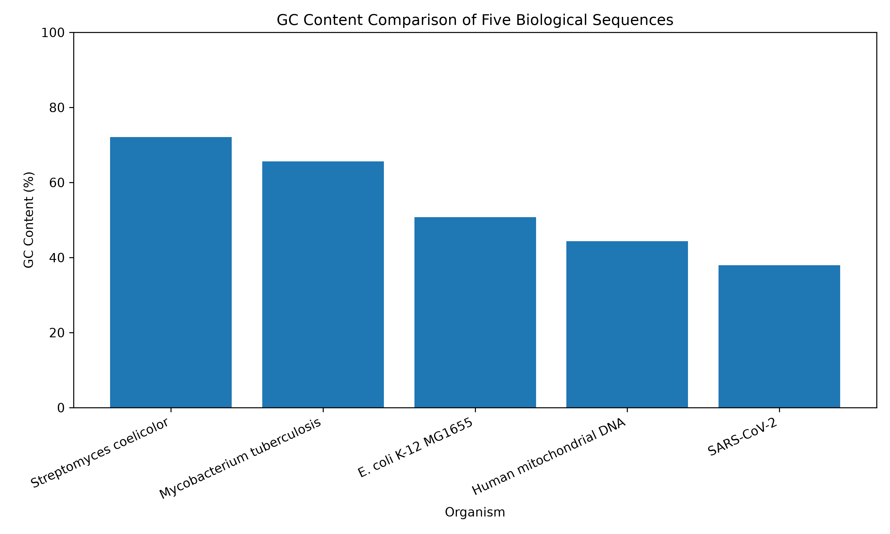
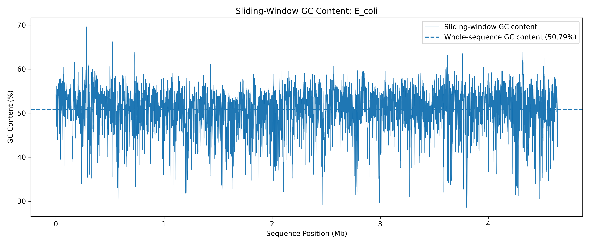
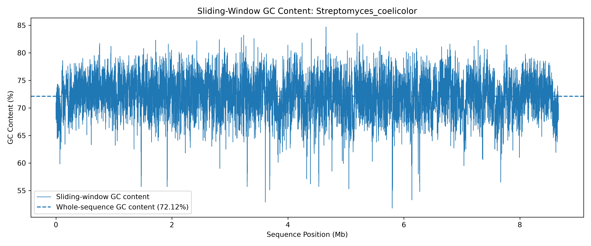

# Comparative GC Content Analysis of Biological Sequences

## 1. Project Overview

This project analyses the guanine-cytosine (GC) content of five biological sequences using Python and bioinformatics libraries. It compares overall GC content and investigates regional GC-content variation using a sliding-window approach.

The project includes sequence retrieval, nucleotide composition analysis, data visualisation, and summary statistics.

## 2. Objectives

- Retrieve biological sequences in FASTA format.
- Calculate the counts of adenine (A), thymine (T), guanine (G), and cytosine (C).
- Calculate the overall GC content of each sequence.
- Compare GC content across five biological sequences.
- Analyse regional GC-content variation using sliding windows.
- Identify the highest- and lowest-GC windows in each sequence.
- Generate CSV tables and plots for further interpretation.

## 3. Biological Sequences

The project analyses the following reference sequences:

| Organism or sample | Accession number |
|---|---|
| Streptomyces coelicolor | NC_003888.3 |
| Mycobacterium tuberculosis H37Rv | NC_000962.3 |
| Escherichia coli K-12 MG1655 | NC_000913.3 |
| Human mitochondrial DNA | NC_012920.1 |
| SARS-CoV-2 | NC_045512.2 |

## 4. Tools and Libraries

- Python: scripting and numerical calculations.
- Biopython: reading FASTA files and handling biological sequences.
- Pandas: tabular data processing and CSV generation.
- Matplotlib: plotting and data visualisation.
- Ubuntu on WSL: command-line development environment.
- Conda: Python environment management.

## 5. Methodology

### 5.1 Sequence Retrieval

Reference sequences were downloaded from the NCBI Nucleotide database in FASTA format using Biopython's Entrez utilities.

### 5.2 Nucleotide Composition and Overall GC Content

The counts of A, T, G, and C were calculated for each sequence. Ambiguous or other characters were counted separately.

GC content was calculated as:

GC content (%) = [(G + C) / (A + T + G + C)] × 100

Only recognised A, T, G, and C bases were included in the denominator.

### 5.3 Sliding-Window Analysis

Regional GC content was calculated using a window size of 1,000 base pairs and a step size of 500 base pairs.

Each window was analysed independently. Consecutive windows overlap by 500 base pairs, and incomplete windows at the end of a sequence were excluded.

### 5.4 Visualisation

A bar chart was generated to compare overall GC content across the five sequences. Separate line plots were generated to show sliding-window GC content along each sequence.

### 5.5 Summary and Validation

The overall GC percentages were compared with the mean window-level GC percentages. The highest- and lowest-GC windows were also identified, and their positions were recorded.

## 6. Results

| Organism or sample | Sequence length (bp) | Overall GC (%) |
|---|---:|---:|
| Streptomyces coelicolor | 8,667,507 | 72.12 |
| Mycobacterium tuberculosis | 4,411,532 | 65.61 |
| Escherichia coli K-12 MG1655 | 4,641,652 | 50.79 |
| Human mitochondrial DNA | 16,569 | 44.36 |
| SARS-CoV-2 | 29,903 | 37.97 |

Streptomyces coelicolor showed the highest overall GC content, while SARS-CoV-2 showed the lowest overall GC content among the sequences analysed.

Regional GC-content variation was observed in all five sequences. Escherichia coli showed the widest range of sliding-window GC percentages in this analysis.

## 7. Output Files

The `results/` directory contains the generated tables and visualisations:

- `gc_content_results.csv`: overall nucleotide composition and GC content.
- `gc_content_comparison.png`: bar chart comparing overall GC content.
- `ecoli_sliding_window_gc.csv`: sliding-window measurements for E. coli.
- `ecoli_sliding_window_gc.png`: sliding-window GC-content plot for E. coli.
- `sliding_window/`: sliding-window CSV files for all five sequences.
- `sliding_window/plots/`: individual sliding-window plots for all five sequences.
- `gc_validation_comparison.csv`: comparison of whole-sequence and mean window GC content.
- `final_gc_summary.csv`: consolidated summary of GC statistics and extreme windows.

## 8. Limitations

GC content describes nucleotide composition but does not independently establish gene function, evolutionary relationships, or biological mechanisms.

Sliding-window results depend on the selected window size and step size. Overlapping windows are not statistically independent, and excluding incomplete final windows can contribute to small differences between whole-sequence and mean window GC content.

## 9. Conclusion

This project demonstrates a reproducible Python-based workflow for comparing GC content across biological sequences. Combining nucleotide composition calculations, sliding-window analysis, CSV outputs, and visualisations provides a foundation for further bioinformatics investigations.

## 10. Reproducibility

The analysis scripts and downloaded sequence files should be retained alongside the results. The Python environment can be recreated using the project's requirements file.

Activate the Conda environment before running the scripts:

conda activate gc-analysis

Run the analysis scripts from the project root directory.

## 11. Discussion

### 11.1 Overall GC Content

*Streptomyces coelicolor* had the highest overall GC content (72.12%), followed by *Mycobacterium tuberculosis* (65.61%). *Escherichia coli* had an intermediate value (50.79%), while human mitochondrial DNA (44.36%) and SARS-CoV-2 (37.97%) had lower values.

GC content reflects nucleotide composition and can be influenced by evolutionary processes such as mutation patterns and natural selection. Codon usage and the composition of coding and non-coding regions can also contribute to observed patterns. However, this project measures GC content only; it does not directly test which mechanisms caused the differences.

SARS-CoV-2 has a comparatively low-GC RNA genome. Mutation patterns and selection may influence its composition, but GC content alone cannot establish a specific role for host adaptation or codon bias. Human mitochondrial DNA also has a distinct genome organisation and evolutionary history from nuclear DNA.

### 11.2 Regional GC Variation

*E. coli* showed the widest observed sliding-window GC range, from 28.6% to 69.6%, a difference of 41.0 percentage points.

Regional variation may reflect differences in gene and intergenic-region composition, horizontally acquired DNA, or genomic features such as ribosomal RNA operons. These are possible explanations, not conclusions from this analysis. Testing them would require additional analyses using genome annotations and known genomic features.

### 11.3 Interpreting Window-Level Results

Mean sliding-window GC percentages were close to the whole-sequence GC percentages. Small differences can arise because incomplete final windows were excluded, overlapping windows represent regions more than once, and window percentages were rounded before being saved.

## 12. Visualisations

### Overall GC Content Comparison

### E. coli Sliding-Window GC Content

### Streptomyces coelicolor Sliding-Window GC Content

The individual plots for *Mycobacterium tuberculosis*, human mitochondrial DNA, and SARS-CoV-2 are available in `results/sliding_window/plots/`.

## 13. Future Work

Potential extensions of this project include:

- **GC skew analysis:** Examine differences between guanine and cytosine distribution across genomic regions.
- **GC3 analysis:** Calculate GC content at the third position of coding-sequence codons.
- **Genome annotation:** Compare GC variation with genes, intergenic regions, and other annotated features.
- **Additional organisms:** Include more bacterial, viral, and eukaryotic genomes.
- **Statistical comparisons:** Test whether observed differences between sequences or genomic regions are statistically meaningful.

## 14. Script Execution Guide

Run the commands below from the project root directory.

### 14.1 Activate the Environment

conda activate gc-analysis

### 14.2 Download Reference Sequences

python download_all_sequences.py

This downloads five reference sequences from NCBI into the data/ directory. Existing FASTA files are skipped.

Before downloading, ensure the Entrez.email setting in download_all_sequences.py contains a valid email address.

### 14.3 Calculate Overall GC Content

python analyze_all_sequences.py

Output: results/gc_content_results.csv

### 14.4 Calculate Sliding-Window GC Content

python sliding_window_all.py

This uses a window size of 1,000 bp and a step size of 500 bp.

Output: five CSV files in results/sliding_window/.

### 14.5 Generate the Final Summary

python create_final_summary.py

Output: results/final_gc_summary.csv

### 14.6 Generate Visualisations

python plot_gc_content.py

Output: results/gc_content_comparison.png

python plot_all_sliding_windows.py

Output: five plots in results/sliding_window/plots/.

### 14.7 Identify GC Extremes

python find_gc_extremes.py

This reports the highest and lowest GC-content windows for each sequence.

### 14.8 Validate and Verify Results

python validate_gc_results.py

Output: results/gc_validation_comparison.csv

python verify_sequence_results.py

This recalculates overall sequence lengths and GC percentages and compares them with the saved results.

### 14.9 Notes

- Run the overall GC analysis and sliding-window analysis before generating the final summary or sliding-window plots.
- The validation comparison checks overall GC against mean window GC; it does not independently verify every window.
- The plotting script uses predefined whole-sequence GC values as reference lines. Update these values if the input sequences or overall GC results change.
- The original E. coli-only scripts are available for the earlier single-sequence workflow: gc_analysis.py, sliding_window_gc.py, plot_sliding_window_gc.py, and download_sequence.py.
